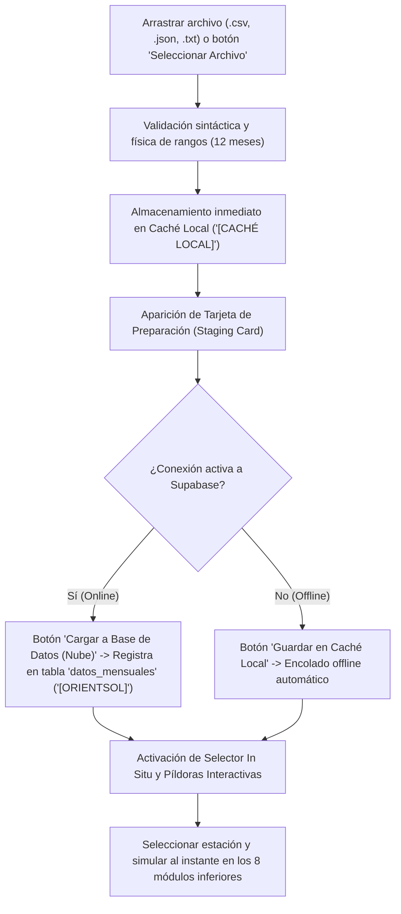

# OrientSol 4.0: Entorno Web y Multiplataforma para Optimización Solar Fotovoltaica

[](https://github.com/Milagros1211/OrientSol4_Completo/releases)
[](https://Milagros1211.github.io/OrientSol4_Completo/)
[](https://github.com/Milagros1211/OrientSol4_Completo/actions/workflows/build-offline-releases.yml)
[](orientsol-web/package.json)
[-brightgreen)](orientsol-web/supabase_schema.sql)
[](LICENSE)
[](https://vitejs.dev/)
[](https://pyodide.org/)
[](https://capacitorjs.com/)

---

> 🎓 **Proyecto de Trabajo Fin de Máster (TFM)**  
> **Máster Universitario en Energías Renovables — Universidad de Jaén (UJA)**  
> **Autora:** Karina Milagros Baldeón Zárate | **Tutoría:** Dr. Leocadio Hontoria García & Dra. Catalina Rus Casas  
> *Versión Final Académica (v4.0.0): modernización, validación y migración de OrientSol desde MATLAB hacia un entorno web y multiplataforma autónomo.*

---

## 🚀 Acceso Rápido y Descargas Oficiales (v4.0.0 - Versión TFM)

OrientSol 4.0 se encuentra disponible en formato **100% Offline** (sin necesidad de Internet ni licencias de MATLAB) para todas las plataformas, así como en versión Web:

| Plataforma | Tipo de Binario | Enlace de Descarga / Acceso | Estado |
| :--- | :--- | :--- | :--- |
| 🌐 **Web en Vivo (Online/PWA)** | Aplicación Web Progresiva | [🔗 Abrir OrientSol 4.0 Web](https://Milagros1211.github.io/OrientSol4_Completo/) | ✅ Operativo (Versión TFM) |
| 🪟 **Windows (10 / 11)** | Instalador `.exe` + Portable | [📥 Descargar para Windows (Releases)](https://github.com/Milagros1211/OrientSol4_Completo/releases/latest) | ✅ 100% Offline |
| 🍎 **macOS (Intel & Apple Silicon)** | Imagen de Disco `.dmg` + `.zip` | [📥 Descargar para macOS (Releases)](https://github.com/Milagros1211/OrientSol4_Completo/releases/latest) | ✅ 100% Offline |
| 🤖 **Android (Móviles & Tablets)** | Paquete de Instalación `.apk` | [📥 Descargar para Android (Releases)](https://github.com/Milagros1211/OrientSol4_Completo/releases/latest) | ✅ 100% Offline |

> 📦 **Descargas directas desde GitHub Actions:**  
> También puedes descargar los binarios recién generados en cualquier momento desde la sección de **Artifacts** de cada compilación en:  
> [🔗 Acceder a GitHub Actions Artifacts](https://github.com/Milagros1211/OrientSol4_Completo/actions/workflows/build-offline-releases.yml)

---

## 📲 Guía Detallada de Instalación por Plataforma

### 🪟 1. Windows (10 / 11)
OrientSol para Windows incluye el entorno de ejecución científico empotrado (Pyodide WebAssembly + NumPy 2.4):
1. Descarga el archivo instalador `OrientSol 4.0 Setup 4.0.0.exe` o el ejecutable directo `OrientSol 4.0 4.0.0.exe`.
2. Haz doble clic para ejecutarlo.
3. *Aviso de seguridad (SmartScreen):* Al ser un ejecutable nuevo y de código abierto sin firma comercial de pago, Windows puede mostrar la ventana azul *"Windows protegió su PC"*. Haz clic en **"Más información"** y luego en **"Ejecutar de todas formas"**.
4. ¡Listo! La aplicación se iniciará de forma instantánea en modo ventana con aceleración por hardware.

### 🍎 2. macOS (macOS 12 Monterey o superior)
1. Descarga la imagen de disco `OrientSol 4.0-4.0.0.dmg`.
2. Haz doble clic en el archivo descargado para montarlo.
3. Arrastra el icono de **OrientSol 4.0** a la carpeta **Aplicaciones**.
4. *Aviso de Gatekeeper:* La primera vez que lo abras, si macOS indica que el desarrollador no ha sido verificado, haz clic derecho (o `Ctrl + clic`) sobre **OrientSol 4.0** en Aplicaciones y selecciona **"Abrir"** en el menú contextual, luego pulsa **"Abrir"** en el cuadro de diálogo.

### 🤖 3. Android (Smartphones y Tablets - Android 7.0 a 16)
La versión para Android está optimizada con diseño responsivo adaptativo tanto para teléfonos en vertical como para tablets en apaisado:
1. Descarga el paquete `OrientSol-Android-APK.zip` o `app-debug.apk` directamente en tu dispositivo o transfiérelo desde el PC.
2. Abre el archivo `.apk` descargado desde la barra de notificaciones o con tu explorador de archivos preferido.
3. Si el sistema te lo solicita, activa el permiso de **"Instalar aplicaciones de fuentes desconocidas"** para ese navegador o gestor de archivos en *Ajustes > Seguridad*.
4. Pulsa **"Instalar"** y luego abre **OrientSol 4.0**. Funciona de inmediato sin necesidad de datos móviles ni Wi-Fi.

### 🌐 4. Navegador Web / PWA (Multiplataforma)
1. Entra a [https://Milagros1211.github.io/OrientSol4_Completo/](https://Milagros1211.github.io/OrientSol4_Completo/).
2. Si deseas instalarla en tu escritorio o pantalla de inicio, en Chrome/Edge haz clic en el icono de **"Instalar OrientSol"** en la barra de direcciones superior. En Safari iOS, pulsa **"Compartir" > "Añadir a pantalla de inicio"**.

---

---

## 📁 Guía Completa de Formatos de Subida y Flujo de Ingesta Digital (Pestaña 3: CSV / JSON / TXT)

OrientSol 4.0 incorpora un motor universal de ingesta y validación climática en cliente diseñado para procesar archivos de radiación y temperatura tanto para **un único emplazamiento** como para **lotes masivos de múltiples emplazamientos simultáneos (Batch)**.

Los archivos subidos se validan matemáticamente en milisegundos mediante WebAssembly/TypeScript, se almacenan de forma segura bajo una **arquitectura híbrida dual** (Caché Local para uso offline y sincronización opcional en la nube con **Supabase**, tabla `datos_mensuales`), y permiten ejecutar **simulaciones directas in situ** sin necesidad de recargar la aplicación ni cambiar de pantalla.

---

### 🔄 Flujo de Funcionamiento Actualizado en la Aplicación Web

El funcionamiento de la pestaña **3. Subida Digital (CSV / JSON)** sigue un flujo de trabajo optimizado en 5 etapas continuas:



1. **Carga y Validación Automática:**
   Arrastra tu archivo a la zona de caída (*Dropzone*) o pulsa el botón **«Seleccionar Archivo»** (admite extensiones `.csv`, `.json` y `.txt`). El analizador inteligente verifica de inmediato que las coordenadas sean válidas y que se disponga del vector completo de 12 meses de irradiancia y temperatura.
2. **Almacenamiento Dual Inmediato (Caché Local + Nube):**
   * **Caché Local Inmediata (`[CACHÉ LOCAL]`):** Nada más leer el archivo, los emplazamientos se guardan automáticamente en la memoria local del navegador (IndexedDB / localStorage). Ya quedan disponibles al 100% para realizar cálculos sin conexión y son localizables en los buscadores con la etiqueta distintiva `[CACHÉ LOCAL]`.
   * **Banner de Estado de Permisos:** La interfaz muestra un indicador dinámico en tiempo real:
     - 🟢 *Carga Online a Supabase: PERMITIDA* (cuando hay conectividad con la base de datos).
     - 🟠 *Carga Online a Supabase: NO PERMITIDA (Modo Offline)* (funciona de forma autónoma local).
3. **Tarjeta de Preparación (*Staging Card*) y Carga a Base de Datos:**
   Aparece un panel que detalla el nombre del archivo, el número total de emplazamientos detectados y sus nombres. Al pulsar el botón principal **«Cargar a Base de Datos (Nube)»**, el sistema ejecuta el protocolo de inserción en Supabase (tabla `datos_mensuales` con `es_oficial = false`). Una vez sincronizado, la etiqueta de los emplazamientos pasa automáticamente a ser **`[ORIENTSOL]`**.
4. **Simulación y Cálculo Directo In Situ (Sin salir de la Pestaña 3):**
   * **Buscador y Selector Integrado:** En la misma pantalla de subida se despliega una barra de búsqueda con autocompletado y menú desplegable para consultar y activar cualquier estación registrada en la nube o en caché local.
   * **Píldoras Interactivas (Lotes Multi-Estación):** Si el archivo contiene varios emplazamientos (p. ej. un lote con *Jaén*, *Madrid*, *Sevilla* o *Arequipa* y *Lima*), aparecen botones en forma de píldora interactiva para cada ciudad con su respectiva etiqueta de estado. Al hacer clic sobre cualquiera de ellos, sus 12 meses de irradiancia $G_{dm}(0)$ y temperatura $T_{amb}$ se cargan en el acto.
   * **Cálculo Instantáneo:** Justo debajo se actualizan la tabla mensual, los gráficos interactivos y los paneles de los **8 módulos de estudio solar** (Inclinación Anual Óptima, Mensual, Estacional, Seguimiento Polar, Azimutal, Horizontal, 2 Ejes y Comparativa Global).
5. **Tarjeta de Éxito y Redirección al Catálogo Oficial:**
   Tras completar el guardado, se muestra una tarjeta de confirmación con el botón **«Ir a Pestaña 1 (Catálogo Oficial) y Ver en Desplegable»**, permitiendo al usuario trasladarse cómodamente a la pestaña principal del catálogo histórico manteniendo la estación activa.

---

### 🛡️ Reglas de Validación, Integridad Física y Control Antiduplicados

Para asegurar la máxima calidad de los datos climáticos ingresados, OrientSol 4.0 aplica un sistema de auditoría con cuatro niveles de verificación:

| Regla / Filtro | Criterio de Aceptación | Comportamiento del Sistema |
| :--- | :--- | :--- |
| **Separadores y Decimales** | Delimitador `,` o `;` \| Decimal `.` o `,` | Detección y normalización automática universal. |
| **Normalización de Radiación** | $G_{dm}(0) \le 15.0\text{ kWh/m}^2/\text{día}$ | Si se introducen valores superiores a $25$, OrientSol detecta que es radiación mensual acumulada ($\text{kWh/m}^2/\text{mes}$) y la divide entre los días del mes ($[31, 28, 31, 30, 31, 30, 31, 31, 30, 31, 30, 31]$) para calcular la media diaria diaria equivalente. |
| **Rangos Físicos Admisibles** | Latitud: $[-90^\circ, +90^\circ]$<br>Longitud: $[-180^\circ, +180^\circ]$<br>Temperatura: $[-60^\circ\text{C}, +65^\circ\text{C}]$<br>Radiación: $[0.01, 15.0\text{ kWh/m}^2/\text{d}]$ | Rechazo preventivo si faltan meses, si los valores contienen caracteres alfabéticos o si se violan los límites físicos de la constante solar. |
| **Antiduplicados 1: Coordenadas** | Tolerancia geográfica $< 0.005^\circ$ ($\approx 500\text{ m}$) | Alerta de duplicidad si ya existe una estación en el mismo punto geográfico. |
| **Antiduplicados 2: Similitud de Nombre** | Distancia de Levenshtein $\ge 90\%$ | Bloqueo si el nombre es casi idéntico. **Excepción inteligente:** Si los nombres incluyen años explícitos distintos (p. ej. *Lima 2025* vs *Lima 2026*), el sistema los admite como series temporales anuales diferentes. |
| **Antiduplicados 3: Perfil Numérico** | Correlación numérica $\ge 90\%$ | Identifica si los 12 meses de datos radiométricos ya han sido registrados previamente bajo otro nombre. |

---

### 📋 Estructura de Datos Almacenada en Supabase (Tabla `datos_mensuales`)

Cuando se confirma la subida a la nube, OrientSol descompone el emplazamiento en **12 registros normalizados** (uno por cada mes) en la tabla `datos_mensuales` de PostgreSQL con los siguientes campos:

| Campo en Base de Datos | Tipo | Descripción y Validación |
| :--- | :--- | :--- |
| `nombre_emplazamiento` | `VARCHAR(200)` | Nombre identificativo del emplazamiento (saneado contra XSS y SQLi). |
| `latitud` | `NUMERIC` | Latitud en grados decimales (Sur negativo, Norte positivo). |
| `longitud` | `NUMERIC` | Longitud en grados decimales (Oeste negativo, Este positivo). |
| `mes` | `INTEGER` | Mes del año del 1 (enero) al 12 (diciembre). |
| `radiacion_media` | `NUMERIC` | Radiación solar acumulada mensual en $\text{kWh/m}^2/\text{mes}$ ($G_{dm}(0) \times \text{días del mes}$). |
| `temp_media` | `NUMERIC` | Temperatura media ambiental mensual en $^{\circ}\text{C}$. |
| `es_oficial` | `BOOLEAN` | Asignado siempre en `false` para distinguir las aportaciones de usuario de las estaciones oficiales del TFM. |
| `creado_en` | `TIMESTAMP` | Marca temporal automática de inserción y trazabilidad. |

> ℹ️ **Nota sobre parámetros adicionales:** Propiedades como el país, altitud o albedo del suelo ($\rho$) son aprovechadas durante la sesión de cálculo en memoria y en la exportación de informes, pero la tabla central `datos_mensuales` almacena estrictamente las variables astronómicas y climáticas normalizadas anteriores.

---

### 1. Formatos para Cargar un ÚNICO Emplazamiento

#### A. Formato CSV Individual (Vertical - Homogenizado y Oficial)
Consta de cabeceras de metadatos precedidas por `#` o `//` y 12 filas con los datos de cada mes del año. Emplea la misma nomenclatura homogénea que la base de datos y el formato en lote (`mes;radiacion_media;temp_media`) con delimitador punto y coma `;`:

```csv
# OrientSol 4.0 - Plantilla de Climatología Individual
# Localidad: Jaén
# Latitud: 37.7796
# Longitud: -3.7849
# Radiación: en kWh/m²/día (ej: 2.45) o mensual en kWh/m²/mes (se convierte automáticamente)
mes;radiacion_media;temp_media
1;2.45;9.2
2;3.31;10.5
3;4.68;13.8
4;5.82;16.5
5;6.95;20.8
6;7.92;26.1
7;8.10;29.4
8;7.25;28.9
9;5.54;24.5
10;3.95;19.1
11;2.75;13.2
12;2.18;10.0
```

> **Significado de Columnas:**
> - `mes`: Número del mes del 1 al 12.
> - `radiacion_media`: Radiación solar global diaria media en plano horizontal ($G_{dm}(0)$) en $\text{kWh/m}^2/\text{día}$ (o acumulada mensual si $> 25$).
> - `temp_media`: Temperatura media ambiental ($T_{amb}$) en grados Celsius ($^{\circ}\text{C}$).
>
> *(Nota de compatibilidad: Por flexibilidad, el analizador también reconoce delimitadores por coma `,` y denominaciones alternativas como `Mes,Gdm0_kWh_m2_dia,Temperatura_C` o `Tamb`, garantizando compatibilidad retroactiva total).*

---

#### B. Formato CSV Individual (Horizontal)
Distribución compacta en tres filas homogéneas precedidas por las cabeceras comentadas con `#`:

```csv
# Localidad: Jaén
# Latitud: 37.7796
# Longitud: -3.7849
mes;1;2;3;4;5;6;7;8;9;10;11;12
radiacion_media;2.45;3.31;4.68;5.82;6.95;7.92;8.10;7.25;5.54;3.95;2.75;2.18
temp_media;9.2;10.5;13.8;16.5;20.8;26.1;29.4;28.9;24.5;19.1;13.2;10.0
```

---

#### C. Formato JSON Individual (Nativo OrientSol)
Objeto JSON estándar con las propiedades obligatorias `locationName`, `latitude`, `longitude`, `monthlyGdm0` (array de 12 números) y `monthlyTemperature` (array de 12 números):

```json
{
  "locationName": "Jaén",
  "latitude": 37.7796,
  "longitude": -3.7849,
  "monthlyGdm0": [2.45, 3.31, 4.68, 5.82, 6.95, 7.92, 8.10, 7.25, 5.54, 3.95, 2.75, 2.18],
  "monthlyTemperature": [9.2, 10.5, 13.8, 16.5, 20.8, 26.1, 29.4, 28.9, 24.5, 19.1, 13.2, 10.0]
}
```

---

### 2. Formatos para Cargar MÚLTIPLES Emplazamientos (Lote / Batch)

#### A. Formato CSV Multi-Emplazamiento (Lote Tabular Oficial)
Permite subir decenas o cientos de emplazamientos en un único archivo estructurado mediante punto y coma `;` o coma `,`. Cada ciudad ocupa 12 filas (una por cada mes):

```csv
# OrientSol 4.0 - Plantilla de Lote Multi-Emplazamiento (Batch)
# Formato: emplazamiento;latitud;longitud;mes;radiacion_media;temp_media
# Radiación: en kWh/m²/día (ej: 2.45) o mensual en kWh/m²/mes (se convierte automáticamente)
emplazamiento;latitud;longitud;mes;radiacion_media;temp_media
Jaén;37.77;-3.78;1;2.45;9.2
Jaén;37.77;-3.78;2;3.31;10.5
Jaén;37.77;-3.78;3;4.68;13.8
Jaén;37.77;-3.78;4;5.82;16.5
Jaén;37.77;-3.78;5;6.95;20.8
Jaén;37.77;-3.78;6;7.92;26.1
Jaén;37.77;-3.78;7;8.10;29.4
Jaén;37.77;-3.78;8;7.25;28.9
Jaén;37.77;-3.78;9;5.54;24.5
Jaén;37.77;-3.78;10;3.95;19.1
Jaén;37.77;-3.78;11;2.75;13.2
Jaén;37.77;-3.78;12;2.18;10.0
Madrid;40.41;-3.70;1;2.14;6.1
Madrid;40.41;-3.70;2;3.15;7.9
Madrid;40.41;-3.70;3;4.48;11.2
Madrid;40.41;-3.70;4;5.51;13.5
Madrid;40.41;-3.70;5;6.62;17.8
Madrid;40.41;-3.70;6;7.54;23.3
Madrid;40.41;-3.70;7;7.78;27.8
Madrid;40.41;-3.70;8;6.84;26.7
Madrid;40.41;-3.70;9;5.25;22.0
Madrid;40.41;-3.70;10;3.52;15.9
Madrid;40.41;-3.70;11;2.36;10.1
Madrid;40.41;-3.70;12;1.84;6.9
```

> 💡 **Nota de coordenadas:** El formato tabular es compatible con coordenadas de cualquier parte del mundo (coordenadas negativas para hemisferio sur y hemisferio occidental, por ejemplo: `Arequipa;-16.40;-71.54;...` o `Lima;-12.05;-77.04;...`).

---

#### B. Formato JSON Multi-Emplazamiento (Array de Objetos)
Un array (`[]`) en el que cada elemento es un objeto JSON de emplazamiento con sus vectores de 12 meses:

```json
[
  {
    "locationName": "Jaén",
    "latitude": 37.7796,
    "longitude": -3.7849,
    "monthlyGdm0": [2.45, 3.31, 4.68, 5.82, 6.95, 7.92, 8.10, 7.25, 5.54, 3.95, 2.75, 2.18],
    "monthlyTemperature": [9.2, 10.5, 13.8, 16.5, 20.8, 26.1, 29.4, 28.9, 24.5, 19.1, 13.2, 10.0]
  },
  {
    "locationName": "Madrid",
    "latitude": 40.4168,
    "longitude": -3.7038,
    "monthlyGdm0": [2.14, 3.15, 4.48, 5.51, 6.62, 7.54, 7.78, 6.84, 5.25, 3.52, 2.36, 1.84],
    "monthlyTemperature": [6.1, 7.9, 11.2, 13.5, 17.8, 23.3, 27.8, 26.7, 22.0, 15.9, 10.1, 6.9]
  }
]
```

---

#### C. Compatibilidad con Archivos Exportados de PVGIS (API / Web)
OrientSol 4.0 reconoce e ingiere directamente archivos JSON mensuales descargados desde la plataforma oficial **PVGIS 5.3** de la Comisión Europea (JRC). El analizador detecta el bloque `outputs.monthly`, extrae automáticamente la radiación media horizontal `H(h)_m` o `H(h)`, la temperatura ambiente `T2m` y las coordenadas `inputs.location`, transformándolo al instante en un perfil válido listo para simular.

---

### 3. Descarga Directa de Plantillas Oficiales desde la Aplicación Web

En la propia pestaña **3. Subida Digital (CSV / JSON)** de la plataforma dispones de 4 botones de generación y descarga inmediata para no tener que crear los archivos manualmente:

1. **`Descargar Plantilla CSV`:** Descarga el archivo `plantilla_climatica_individual_orientsol.csv` con la estructura vertical de 12 meses.
2. **`Plantilla CSV (Lote Multi)`:** Descarga el archivo `plantilla_climatica_lote_multi_orientsol.csv` con la estructura tabular multi-ciudad.
3. **`Descargar Plantilla JSON`:** Descarga el archivo `plantilla_climatica_individual_orientsol.json` para un único emplazamiento.
4. **`Plantilla JSON (Lote Multi)`:** Descarga el archivo `plantilla_climatica_lote_multi_orientsol.json` con la lista de objetos de ejemplo.

---

## 💻 Requisitos del Sistema, Instalación y Guía de Uso por Plataforma

OrientSol 4.0 está diseñado para funcionar de manera **100% autónoma y offline** tanto para usuarios finales (mediante instaladores y ejecutables directos sin necesidad de instalar entornos de desarrollo ni licencias de MATLAB) como para desarrolladores o investigadores que deseen ejecutar o compilar el código fuente.

---

### 1. 🪟 Windows (Windows 10 / Windows 11 de 64 bits)

#### A. ¿Qué necesitas para ejecutar la app en Windows?
* **Sistema Operativo:** Windows 10 o Windows 11 (edición de 64 bits).
* **Hardware mínimo recomendado:** Procesador Intel o AMD x64 de doble núcleo, 4 GB de memoria RAM y 350 MB de almacenamiento libre en disco.
* **Dependencias de software:** **Ninguna.** No necesitas tener instalado Node.js, Python, MATLAB ni librerías adicionales. El motor científico de cálculo (Pyodide WebAssembly y NumPy) ya viene empotrado en el ejecutable.
* **Conectividad:** 100% Offline para todos los módulos de cálculo astronómico, optimización y simulación. *(Solo requiere conexión a Internet si se desea consultar dinámicamente las bases de datos externas de PVGIS o NASA POWER).*

#### B. Paso a paso para usar el ejecutable (.exe):
1. **Descarga:** Accede a la sección de [Releases de GitHub](https://github.com/Milagros1211/OrientSol4_Completo/releases/latest) y descarga el instalador `OrientSol 4.0 Setup 4.0.0.exe` (con acceso directo en el escritorio) o la versión portable `OrientSol 4.0 4.0.0.exe` (que no requiere instalación).
2. **Desbloqueo de SmartScreen:** Al ejecutarlo por primera vez, Windows SmartScreen puede mostrar la ventana azul *"Windows protegió su PC"* (al tratarse de una aplicación académica de código abierto sin firma corporativa de pago). Haz clic en el enlace **"Más información"** y luego en el botón **"Ejecutar de todas formas"**.
3. **Arranque del simulador:** La aplicación abrirá su ventana principal al instante. En segundo plano, se inicializa automáticamente el hilo seguro de WebAssembly con Pyodide.
4. **Flujo de uso en la aplicación:**
   * **Paso 1 (Emplazamiento y Climatología):** En el panel superior, selecciona cualquiera de las 4 modalidades disponibles:
     1. *Catálogo Histórico & Supabase:* Búsqueda asistida en las 114 estaciones oficiales o datasets en la nube (`[ORIENTSOL]`).
     2. *Entrada Manual:* Introducción directa de coordenadas y perfil de 12 meses de radiación y temperatura.
     3. *Subida Digital (CSV / JSON / TXT):* Carga de archivos individuales o por lote multi-ciudad con previsualización, guardado dual (caché local y base de datos) y selección directa in situ.
     4. *Consulta Satelital:* Extracción georreferenciada global desde PVGIS 5.3 (SARAH2), NASA POWER o Open-Meteo.
   * **Paso 2 (Módulo de Estudio Solar):** Selecciona el análisis deseado entre los 8 módulos científicos disponibles: *Inclinación Fija Anual*, *Inclinación Mensual*, *Inclinación Estacional*, *Seguimiento Polar*, *Seguimiento Azimutal*, *Seguimiento Horizontal*, *Seguimiento en 2 Ejes* o *Estudio Comparativo Global*.
   * **Paso 3 (Ajuste de Parámetros de Diseño):** Modifica el albedo del suelo ($\rho$), la potencia pico ($P_n$), el Performance Ratio ($PR$), la temperatura de célula ($TONC/NOCT$), o los ángulos de inclinación ($\beta$) y orientación ($\alpha$).
   * **Paso 4 (Cálculo Inmediato):** Pulsa **«Calcular»** (o haz clic en cualquiera de las píldoras de estaciones en lotes). El motor en WebAssembly/Python procesa las integrales solares, ganancias energéticas y pérdidas térmicas en milisegundos.
   * **Paso 5 (Exportación Profesional):** Descarga el informe técnico formal en **PDF**, las series horarias y mensuales en **CSV**, o la auditoría completa en **Excel (.xlsx)**.

---

### 2. 🍎 macOS (macOS 12 Monterey o superior — Apple Silicon & Intel)

#### A. ¿Qué necesitas para ejecutar la app en macOS?
* **Sistema Operativo:** macOS 12 Monterey, macOS 13 Ventura, macOS 14 Sonoma o macOS 15 Sequoia.
* **Arquitectura:** Compatible de forma nativa con procesadores Apple Silicon (M1, M2, M3, M4) y procesadores Intel x86_64.
* **Hardware mínimo recomendado:** 4 GB de memoria RAM unificada y 400 MB de espacio disponible en disco.
* **Dependencias de software:** Ninguna adicional requerida (Pyodide y NumPy integrados en el bundle).

#### B. Paso a paso para usar el descargable (.dmg):
1. **Descarga:** Descarga la imagen de disco `OrientSol 4.0-4.0.0.dmg` desde [GitHub Releases](https://github.com/Milagros1211/OrientSol4_Completo/releases/latest).
2. **Instalación:** Haz doble clic en el archivo `.dmg` descargado y arrastra el icono de **OrientSol 4.0** a la carpeta **Aplicaciones** (`/Applications`).
3. **Desbloqueo de Gatekeeper:** La primera vez que abras la aplicación, macOS indicará que el desarrollador no ha sido verificado. Para autorizarla:
   * Haz clic derecho (o mantén pulsada la tecla `Ctrl` y haz clic) sobre **OrientSol 4.0** en tu carpeta Aplicaciones.
   * Selecciona **"Abrir"** en el menú contextual emergente.
   * En el cuadro de diálogo de confirmación de seguridad de macOS, pulsa **"Abrir"**. *(Solo tendrás que hacer esto la primera vez).*
4. **Uso del Simulador:** La app se ejecuta con aceleración gráfica Metal/Chromium nativa, lista para simular y exportar informes.

---

### 3. 🤖 Android (Smartphones y Tablets — Android 7.0 a 16)

#### A. ¿Qué necesitas para mantener la app en funcionamiento?
* **Sistema Operativo:** Android 7.0 (Nougat, API nivel 24) o cualquier versión superior hasta Android 16.
* **Almacenamiento:** Mínimo 200 MB de memoria interna libre.
* **Permisos del sistema:** Permiso de almacenamiento para guardar informes PDF y archivos exportados CSV/Excel generados por el simulador.
* **Conectividad:** Funciona 100% sin conexión (ideal para ingenieros y técnicos en instalaciones solares aisladas o en cubiertas sin cobertura móvil).

#### B. Paso a paso para usar la aplicación en Android (.apk):
1. **Descarga:** Descarga el paquete `OrientSol-Android-APK.zip` o `app-debug.apk` directamente en tu dispositivo Android o transfiérelo desde un PC mediante cable USB o Google Drive.
2. **Autorización de Fuentes Desconocidas:** Si Android bloquea la instalación por proceder de fuera de Google Play:
   * Accede a *Ajustes > Seguridad > Instalar aplicaciones desconocidas* (o pulsa *"Ajustes"* en el mensaje que aparece al tocar el archivo).
   * Activa la casilla *"Permitir desde esta fuente"* para tu navegador o gestor de archivos.
3. **Instalación:** Toca el archivo `.apk` y pulsa **"Instalar"**. Al finalizar, pulsa **"Abrir"**.
4. **Uso táctil optimizado:** La interfaz se adapta dinámicamente a la orientación de la pantalla (modo vertical para móviles y modo apaisado panorámico con gráficas expandidas en tablets).

---

### 4. 🌐 Navegador Web / PWA (Multiplataforma sin Instalación)

#### A. ¿Qué necesitas?
* Cualquier navegador web moderno con soporte para WebAssembly, Canvas y ES Modules:
  * Google Chrome / Chromium v90+
  * Mozilla Firefox v89+
  * Microsoft Edge v90+
  * Apple Safari (iOS / macOS) v15+
  * Opera, Brave, Vivaldi.

#### B. Paso a paso de uso:
1. Entra directamente a la dirección oficial: [https://Milagros1211.github.io/OrientSol4_Completo/](https://Milagros1211.github.io/OrientSol4_Completo/).
2. **Instalación opcional como PWA (Aplicación Web Progresiva):**
   * En **Google Chrome / Microsoft Edge:** Haz clic en el icono de instalación ⊕ ("Instalar OrientSol") en el extremo derecho de la barra de direcciones.
   * En **Safari (iPhone / iPad):** Pulsa el botón *"Compartir"* (icono con flecha hacia arriba) y selecciona *"Añadir a pantalla de inicio"*.
3. La aplicación se integrará con su propio icono en tu sistema y funcionará incluso cuando no dispongas de conexión a Internet gracias a su Service Worker.

---

### 5. 🛠️ Ejecución y Desarrollo Local desde Código Fuente (Para Desarrolladores)

Si deseas modificar el código fuente, ejecutar el servidor de desarrollo local o recompilar los binarios multiplataforma:

#### Requisitos previos de desarrollo:
* [Node.js](https://nodejs.org/) v18.0.0 o superior (recomendado v20+ LTS).
* Gestor de paquetes `npm` v9.0.0 o superior.
* Para compilar Android: Java JDK 21 y Android Studio con Android SDK configurado.

#### Instalación y arranque del entorno:
```bash
# 1. Clonar el repositorio:
git clone https://github.com/Milagros1211/OrientSol4_Completo.git
cd OrientSol4_Completo

# 2. Instalar dependencias del frontend web:
npm install --prefix orientsol-web

# 3. Iniciar servidor local de desarrollo con Hot Module Replacement (HMR):
npm run dev
# Abre en tu navegador la dirección: http://localhost:5173
```

#### Comandos de Compilación y Empaquetado Multiplataforma:
```bash
# Compilar versión web para distribución final:
npm run build

# Desplegar directamente la versión compilada a GitHub Pages:
npm run deploy

# Iniciar aplicación de escritorio en modo desarrollo con Electron:
npm run app:desktop

# Empaquetar instalador .exe y versión portable para Windows (x64):
npm run --prefix orientsol-web build:win

# Empaquetar instalador .dmg y .zip para macOS:
npm run --prefix orientsol-web build:mac

# Empaquetar para todas las plataformas de escritorio (Windows, macOS):
npm run --prefix orientsol-web build:all

# Sincronizar assets web y compilar APK para Android:
npm run --prefix orientsol-web cap:sync
cd orientsol-web/android && ./gradlew assembleDebug
```

---

## Estructura del Repositorio

```text
├── .github/workflows/
│   └── deploy.yml               # Pipeline de integración continua (CI/CD)
├── orientsol-web/               # Aplicación OrientSol 3.0 (Web, Desktop y Móvil)
│   ├── src/
│   │   ├── components/          # Componentes de UI (Simulador, Gráficos, APIs, Consola)
│   │   ├── database/            # BBDD local de localidades españolas y albedos
│   │   ├── i18n/                # Sistema bilingüe (Español / Inglés)
│   │   ├── python/              # Motor científico solar en Python (Pyodide WebAssembly)
│   │   │   ├── core/            # Geometría solar (declinación, ángulos horarios, altura solar)
│   │   │   ├── radiation/       # Descomposición difusa y transposición a planos inclinados
│   │   │   ├── tracking/        # Algoritmos de seguimiento (1 eje horizontal, polar, azimutal y 2 ejes)
│   │   │   ├── energy/          # Modelo de Osterwald, temperaturas de célula y balances
│   │   │   └── optimization/    # Búsqueda de inclinación óptima y mapas de pérdidas CTE
│   │   ├── services/            # Servicios: WebAssembly, APIs NASA/PVGIS, Supabase
│   │   └── style.css            # Sistema de diseño, estética oscura solar y glassmorphism
│   ├── electron/                # Configuración de escritorio para Windows
│   ├── android/                 # Proyecto nativo para Android
│   ├── public/                  # Runtime de Pyodide WebAssembly y NumPy local
│   └── package.json             # Scripts y dependencias
├── README.md                    # Documentación principal del repositorio
└── package.json                 # Scripts de orquestación raíz
```

---

---

## Marco Legal, Privacidad & Cumplimiento Normativo (UE y España)

OrientSol 4.0 cumple rigurosamente con la normativa europea y española de protección de datos, comercio electrónico y derechos de los consumidores:
* **Reglamento General de Protección de Datos (RGPD 2016/679):** Arquitectura Zero-Tracking con cálculo 100% en cliente (Pyodide WebAssembly) y preservación de derechos ARCO-POL.
* **Ley Orgánica 3/2018 (LOPDGDD):** Garantía de los derechos digitales y seguridad en reposo/tránsito.
* **Términos de Servicio y Declaración de Gratuidad Total:** Software libre sin cobros, compras integradas ni suscripciones comerciales.
* **Informe de Auditoría y Seguridad:** Aislamiento en sandbox WASM, prevención estricta de XSS y de inyección en fórmulas CSV/Excel (CWE-1236), y RLS en base de datos PostgreSQL.

Para consultar el marco legal íntegro, revisa el documento [LEGAL_POLICIES.md](file:///c:/Users/karin/Downloads/PFCOrientSol3/Programas%20fuente/OrientSol3_Completo/LEGAL_POLICIES.md).

---

## Licencia y Derechos de Autor

Desarrollado en el marco del **Máster Universitario en Energías Renovables** de la **Universidad de Jaén (UJA)**.  
Alumna: **Karina Milagros Baldeón Zárate**  
Directores: **Dr. Leocadio Hontoria García** & **Dra. Catalina Rus Casas**  
Código abierto bajo licencia MIT y Acceso Abierto Académico.
